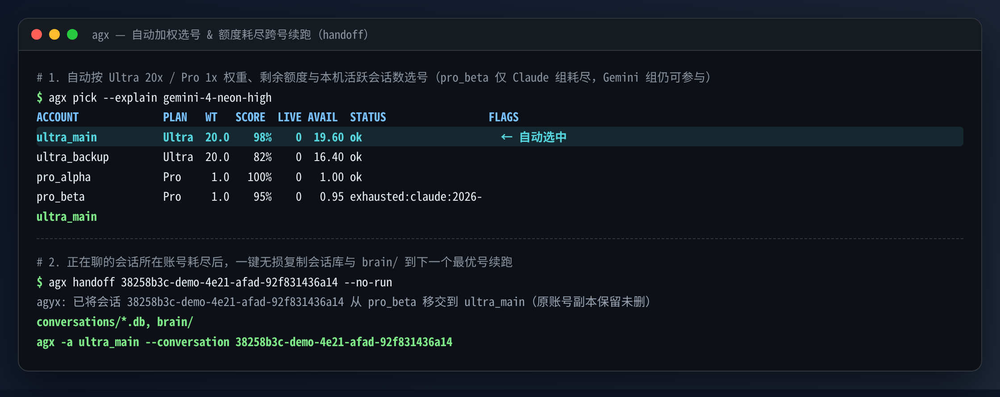
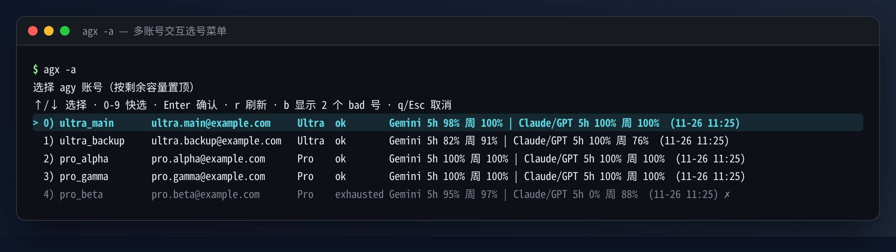
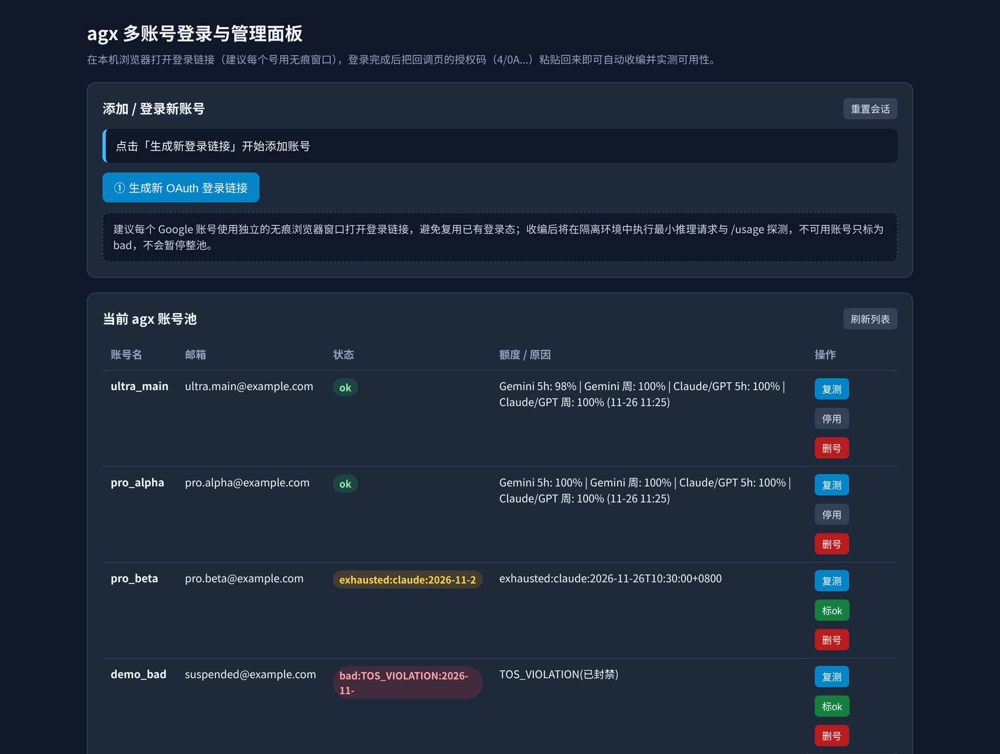

# agx

轻量、无守护进程的多账号 [Antigravity CLI](https://antigravity.google)（`agy`）管理工具集：自动挑选有额度的账号、按模型组隔离 429 冷却、并在单个账号耗尽时将正在进行的会话无损移交到下一个账号续跑。

## 核心机制：自动选号与耗尽处理

### 1. 运行 `agx` 自动选择额度最高的账号

平时直接运行 `agx` 即可，无需手动加 `-a` 挑号：

```bash
# 直接启动：自动选当前可用容量最高的账号（考虑 Ultra/Pro 套餐权重、剩余比例与本机活跃会话数）
agx

# 指定模型或无头执行：按目标模型对应的额度组自动选余量最高的号
agx --model gemini-4-neon-high
agx -p "总结当前仓库的目录结构"

# 查看当前全池实时打分与自动选中的账号
agx pick --explain gemini-4-neon-high
```

每次不带 `-a` 启动时，内部按 4 步自动选号：

1. **按模型映射额度组**：根据目标模型对应到 `Gemini`、`Claude/GPT` 或 `Argon` 额度组。
2. **过滤不可用账号**：跳过 `bad:`、目标组处于 `exhausted:<组>` 或 15 分钟 429 冷却中、任一未到期窗口剩余 ≤ 2%，以及 `models.txt` 中不含目标模型的账号。
3. **过期缓存自动复查**：额度缓存超过 30 分钟时，自动执行官方 `/usage` 刷新并重新判定。
4. **按可用容量最高排序 + LRU 轮转**：实时统计本机各账号正在运行的 `agy` 活跃会话数 `LIVE`，按 **`AVAIL = (套餐权重 × 剩余比例) / (1 + LIVE)`** 从高到低选号（Ultra 默认权重 `20.0`、Pro 权重 `1.0`、Free/Starter `0.2`，反映 Ultra 与 Pro 约 20 倍的真实额度差异），相对 5% 同档位按最久未用（LRU）轮转——活跃会话多的号自动降权分流，新会话优先落到余量最高的 Ultra/Pro 号。

### 2. 一个账号额度用完了怎么办？

| 场景 | 你需要做什么 | `agx` 背后的自动处理 |
| --- | --- | --- |
| **新开会话 / 下一个任务** | 直接照常跑 `agx` | 上一次会话退出时，`agx` 已扫描本次新建日志，将耗尽的模型组标为 `exhausted:<组>` 并写入 15 分钟冷却；下次 `agx` **自动跳过该号**，切到下一个有额度的号。 |
| **Claude 组用完，但想继续跑 Gemini** | 直接跑 `agx --model gemini-...` | 耗尽状态与冷却**按模型组隔离**（`exhausted:claude` 不会挡住同一账号剩余的 Gemini 额度）。 |
| **正在聊的交互会话跑到一半用完了** | 退出后运行 **`agx handoff <会话ID>`** | 自动排除原号并挑选下一个有额度的最优账号，通过 SQLite `backup()` 原子复制 WAL 会话库、`brain/`、`annotations/` 与当前目录信任记录，并直接 `--conversation` 接着聊（原账号副本保留不删）。 |
| **窗口重置、额度恢复后** | 无需操作（或手动 `agx usage <账号>`） | 过冷却期且满 30 分钟后，下次选号自动 `/usage` 复查并恢复 `ok`；也可在 `agx -a` 菜单按 `r` 立即刷新恢复。 |



## 界面预览

### 交互式选号菜单（`agx -a`）

需要手动挑号时执行 `agx -a`：按 Ultra/Pro 加权剩余容量置顶排序，默认隐藏 `bad` 账号（按 `b` 切换显示），支持上下键 / 数字键快选与 `r` 键实时刷新单行额度：



### 本地登录与测活面板（`agx-web`）

面向远程开发机批量添加账号的可选本地 Web 页面（默认仅监听 `127.0.0.1:8789`，需 `web.token` 鉴权）：生成 OAuth 登录链接、提交回调授权码自动收编、在隔离环境实测可用性与额度（坏号仅标 `bad`，不会暂停整池）：



## 设计原则

- **每个账号独立 `HOME`**：每个账号拥有独立的 `~/.local/share/agy-pool/accounts/<账号名>/home/`，多终端并发互不覆盖 OAuth 凭据与会话库；真实家目录的 `git`、`ssh`、`.gemini/skills`、`.gemini/config` 等通过软链共享。
- **零守护进程、不读取凭据文件**：所有登录、额度查询、模型列表和推理请求都交给官方 `agy` 进程完成，工具本身不读取、不解析、不打印 `antigravity-oauth-token`。
- **加权负载均衡与模型组隔离**：按 `(套餐权重 × 目标模型组剩余比例) / (1 + 当前活跃会话数)` 动态选号，同档位按最久未用（LRU）轮转；Gemini / Claude&GPT / Argon 三个额度组的 429 冷却与耗尽状态彼此独立。
- **跨账号无损续跑（`handoff`）**：某个账号额度耗尽后，通过 SQLite `backup()` 原子复制 WAL 会话库、`brain/`、`annotations/` 与当前目录信任记录到下一个可用账号并直接 `--conversation` 续跑。

## 目录结构

```text
agx/
├── bin/
│   ├── agx                 # 核心 CLI（多账号隔离、轮转选号、交互菜单、handoff、模型目录缓存）
│   ├── agx-web             # 本地 Web 登录与隔离实测面板（默认仅监听 127.0.0.1 + token 鉴权）
│   ├── agx-kaboo-sync      # 将各账号会话库软链同步到 ~/.gemini/antigravity-cli/conversations/
│   └── agx-appeal-watch    # 隔离式异常/申诉账号定期存活巡检（可选接入自定义通知命令）
├── config/
│   ├── statusline.sh       # Antigravity CLI 3 行状态栏（模型、上下文、TPS、5h/周额度、目录/分支）
│   └── title.sh            # 终端窗口标题脚本
├── tests/
│   └── test_agx.py         # 隔离环境单元测试与脱敏守卫
├── config.env.example      # ~/.config/agx/config.env 配置模板
└── install.sh              # 软链安装 / 卸载脚本
```

## 快速安装

前置依赖：`bash`、`python3`（3.9+）、已安装的 `agy`（可选：`tmux` 用于 `agx-web`）。

```bash
git clone <你的仓库地址> ~/Code/agx
cd ~/Code/agx

# 仅安装核心 CLI（agx / agyx / agx-web / agx-appeal-watch）
./install.sh

# 安装全套（含状态栏、窗口标题、agx-kaboo-sync 和默认 ~/.config/agx/config.env）
./install.sh --all

# 卸载（仅移除由本仓库创建的软链，不删账号池数据与配置文件）
./install.sh --uninstall
```

确保 `~/.local/bin` 在 `PATH` 中，验证：

```bash
agx --help
agx ls
```

## 配置说明

配置文件路径默认为 `~/.config/agx/config.env`（可用 `AGX_CONFIG` 覆盖），模板见 [config.env.example](config.env.example)。

命令行显式传入的环境变量优先级高于 `config.env`。常用配置项：

| 变量 | 默认值 | 说明 |
| --- | --- | --- |
| `AGYX_ROOT` | `~/.local/share/agy-pool` | 账号池数据目录 |
| `AGYX_AGY` | `~/.local/bin/agy`（回退 `PATH`） | `agy` 可执行文件路径 |
| `AGYX_PROXY` | `keep` | `keep` 沿用当前 shell 代理；也可固定指定如 `http://127.0.0.1:7890` |
| `AGYX_NO_PROXY` | `localhost,127.0.0.1,::1,10.0.0.0/8` | 固定代理时的直连列表 |
| `AGYX_PICK_STRATEGY` | `spread` | `spread` 动态加权轮转；`order` 按 `order` 文件固定顺序用尽再换 |
| `AGYX_ULTRA_WEIGHT` / `AGYX_PRO_WEIGHT` | `20.0` / `1.0` | Ultra 与 Pro 套餐容量权重（匹配 20 倍真实额度差） |
| `AGYX_PREFER_PLAN` | 空 | 留空为全池加权轮转；设为 `pro` 或 `ultra` 可限定优先套餐 |
| `AGYX_MIN_PCT` | `2` | 目标模型组任一未到期窗口剩余 ≤ 该百分比视为耗尽 |
| `AGYX_COOLDOWN_MIN` | `15` | 触发 429 后该模型组的短冷却分钟数（`0` 关闭） |
| `AGYX_REFRESH_MIN` | `30` | 额度缓存超过该分钟数时 `auto` 选号先自动刷新 `/usage`（`0` 关闭） |
| `AGYX_PER_ACCOUNT` | `0` | 单账号并发上限（`0` 表示不限） |
| `AGX_WEB_HOST` / `AGX_WEB_PORT` | `127.0.0.1` / `8789` | `agx-web` 监听地址与端口（默认拒绝 `0.0.0.0`） |

## 常用命令

### 1. 添加账号与查看状态

```bash
# 在隔离临时目录登录新账号（不动默认 ~/.gemini），完成后按邮箱前缀入池
agx login

# 把登录中断留下的临时目录收编进池
agx adopt

# 把默认 ~/.gemini 当前登录的账号导入账号池
agx save

# 查看账号池状态、套餐、缓存额度与冷却标签
agx ls

# 刷新额度（默认跳过 bad 账号，全量刷新间隔 20 秒）
agx usage [账号名|all]

# 通过临时 statusLine 零 token 探测套餐类型（Ultra / Pro）
agx plan [账号名|all]

# 缓存各账号的 agy models 可用模型目录（零 token，选号时自动跳过不支持目标模型的号）
agx models-sync [账号名|all]
```

### 2. 启动与选号

```bash
# 自动按加权轮转选一个最优账号启动（默认透传 --dangerously-skip-permissions）
agx [agy 参数...]

# 不带 --dangerously-skip-permissions 启动
agx --safe [agy 参数...]

# 弹出交互式账号菜单（默认隐藏 bad 账号，按 b 展开/隐藏，按 r 刷新当前行额度）
agx -a [agy 参数...]

# 指定账号启动
agx -a <账号名> [agy 参数...]

# 查看当前自动选号结果与全池实时排位明细
agx pick --explain [模型名]

# 临时限定优先套餐
agx pick --prefer-plan pro --explain gemini-4-neon-high
```

### 3. 跨账号无损续跑（handoff）

当某个会话所在账号触发限流或额度耗尽时，将会话完整复制到下一个可用账号继续对话（原账号副本保留不删）：

```bash
# 自动选择下一个最优可用账号并直接 --conversation 续跑
agx handoff <会话ID>

# 指定目标账号，并透传参数给 agy
agx handoff <会话ID> <目标账号> -p "继续刚才的步骤"

# 仅复制文件不立即启动，打印续跑命令
agx handoff <会话ID> --no-run
```

### 4. 风控与暂停恢复

- 单次运行的日志中若出现 `valid license of this product`、`TOS_VIOLATION` 或 `violation of Terms of Service`，该账号会标记为 `bad:` 并自动写入 `$AGYX_ROOT/PAUSED` 暂停整池；人工确认后运行 `agx resume` 恢复。
- 单账号资格不符（地区限制、年龄未验证等）只将该账号标为 `bad:`，不暂停整池。
- 429 额度耗尽按模型组隔离（`exhausted:gemini` / `exhausted:claude` / `exhausted:argon`），只过滤该模型组并写入对应冷却文件 `last_429.<组>`，不影响其他模型组。
- `scan_logs` 仅扫描本次进程新创建的 `cli-*.log` 中 `E` 级推理报错，不会因同账号并发老会话的历史日志或后台 `writeTrajectoryAcls` 偶发 429 产生误判。

### 5. 配套小工具

#### `agx-web`：本地浏览器登录与隔离实测面板

适合远程开发机通过 SSH 端口转发批量登录账号并隔离测活（不可用账号只标 `bad:`，不会暂停整池）：

```bash
# 服务端启动（首次启动在 $AGYX_ROOT/web.token 生成 600 权限随机 token）
agx-web

# 本机 SSH 端口转发后打开终端打印的带 #token=... 链接
ssh -L 8789:127.0.0.1:8789 <你的远程主机>
```

#### `agx-kaboo-sync`：多账号会话统计软链同步

`agy` 各账号会话分散在 `$AGYX_ROOT/accounts/*/home/.gemini/antigravity-cli/conversations/`。运行 `agx-kaboo-sync` 会将所有 `.db`/`.db-wal`/`.db-shm` 以软链同步到 `~/.gemini/antigravity-cli/conversations/`，方便用量统计工具（如 `kaboo-cli`）一次扫齐：

```bash
agx-kaboo-sync
```

#### `agx-appeal-watch`：异常/申诉账号定期巡检

在隔离环境中逐个探测 `bad:` 账号（或指定 `--watchlist` 名单），若真实请求恢复通过则自动改回 `ok`；可选通过 `--notify-cmd`（或 `AGX_WATCH_NOTIFY_CMD`）把 Markdown 报告经 stdin 交给任意外部通知脚本：

```bash
# 仅探测并打印报告，不改状态
agx-appeal-watch --dry-run

# 自动扫描池中所有 bad: 账号并接入自定义通知脚本
agx-appeal-watch --notify-cmd '/path/to/notify.sh'
```

## 运行测试

所有单元测试均在临时隔离目录中运行，不会读取或修改真实的 `~/.local/share/agy-pool`：

```bash
python3 -m unittest discover -s tests -v
```
